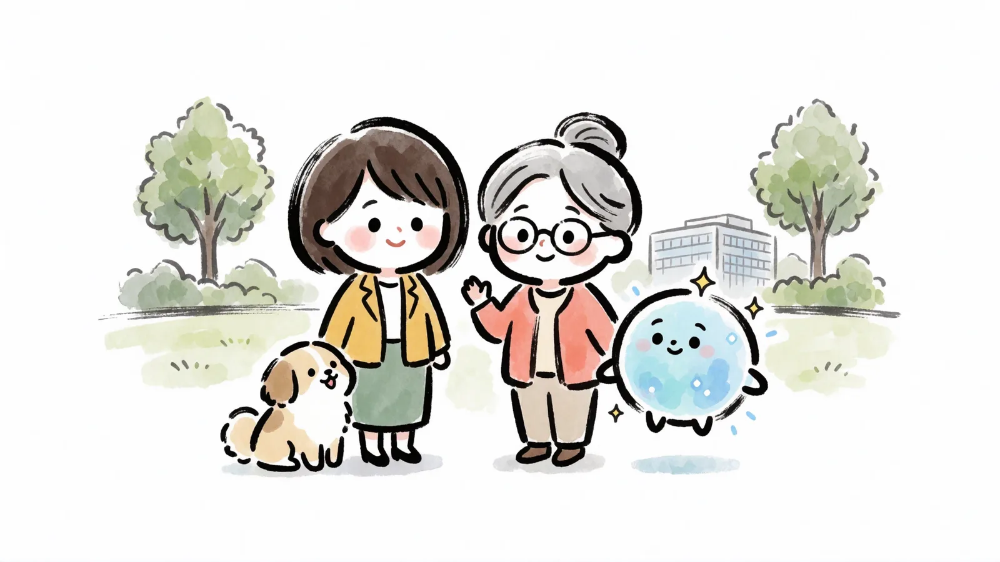
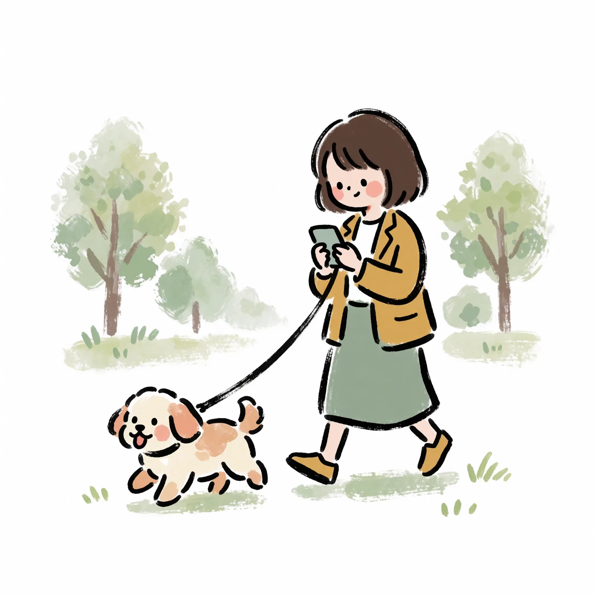
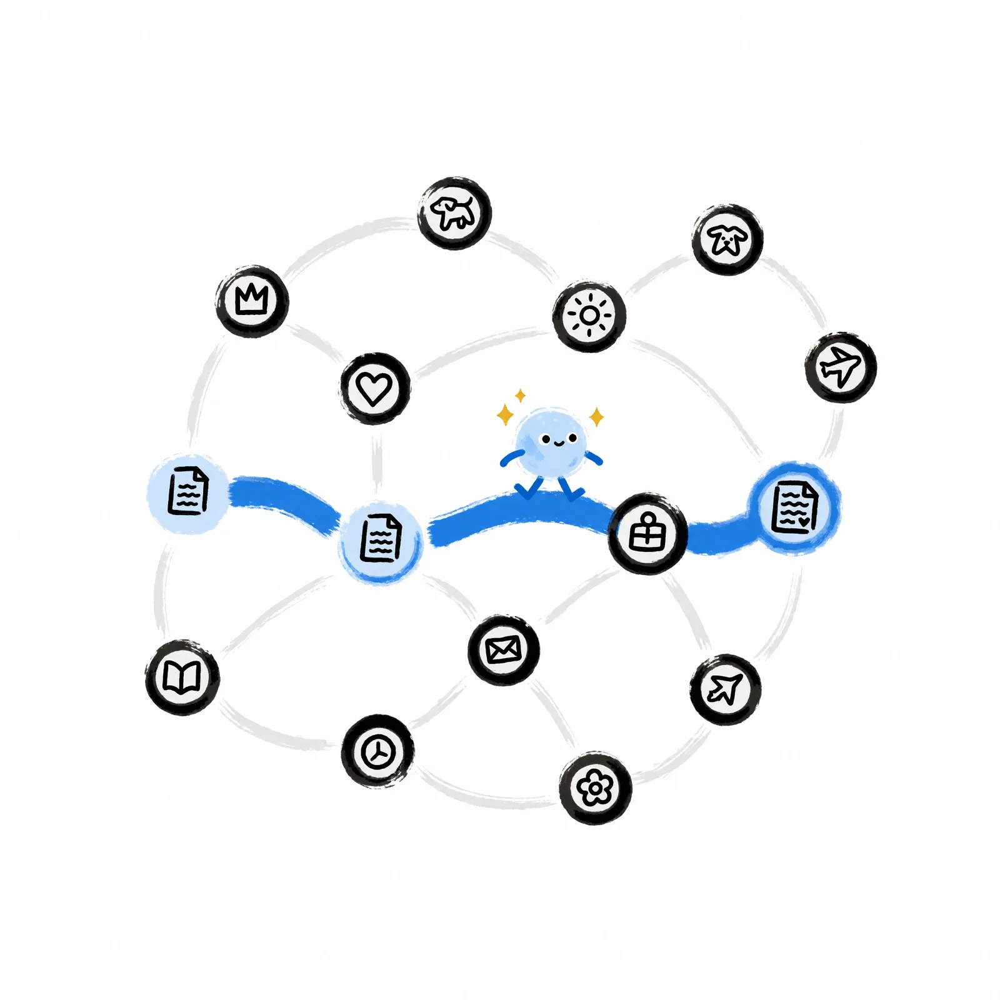
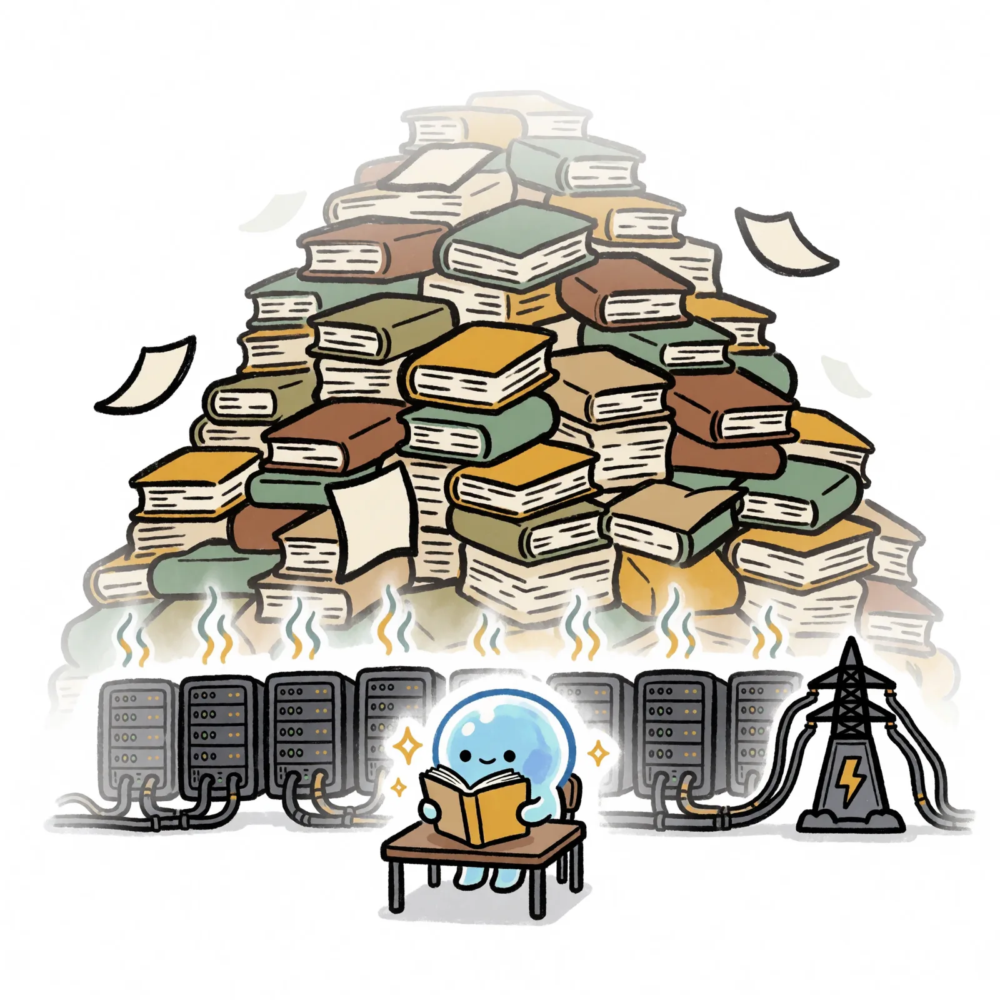

<!-- mb:main id=step1 -->

<!-- mb:block preset=image -->

<!-- mb:/block -->

<!-- mb:block preset=narration -->
Quick word on casting: the little blue one plays the model; the dog plays himself. Too cute? The doomsday edition — the blob recast as a Terminator — is permanently in post-production. Today: cute it is.

We start at a chat window. It could be anyone's — these days, it's everyone's. You type: "write a thank-you note to my aunt." Something types back. A whole, complete thank-you note, in seconds.
<!-- mb:/block -->

---

<!-- mb:columns weights=[1,1] -->
<!-- mb:col -->

## One request in, one response out

A sentence goes in, a finished note comes out. That's the entire thing — and it's where everything starts.

<!-- mb:col -->

<!-- mb:block preset=image -->

<!-- mb:/block -->

<!-- mb:/columns -->

<!-- mb:block preset=narration -->
Everything you need to know starts with what just happened. One request went in — your sentence. One response came out — the note. That's it. That's the entire thing.
<!-- mb:/block -->

---

<!-- mb:columns weights=[1,1] -->
<!-- mb:col -->

## The only move: guess what comes next

Each guess is one step across the map of relations — built in training, walked at inference.

<!-- mb:col -->

<!-- mb:block preset=image -->

<!-- mb:/block -->

<!-- mb:/columns -->

<!-- mb:block preset=narration -->
Now lift the lid, because what's underneath is almost absurd. The machine read your sentence and guessed what piece of text comes next. Each guess is one step across a map of relations that training built — the map was always there; your answer is the walk. Then the next. Then the next — until it had guessed a thank-you note. That's the whole mechanism.
<!-- mb:/block -->

---

<!-- mb:columns weights=[1,1] -->
<!-- mb:col -->

## Nobody wrote it. It grew.

- an unbelievable amount of text
- an unthinkable number of iterations
- an insane fleet of computers
- an ungodly amount of power

… and no line anywhere in it says how to write a thank-you note. The ability grew, the way abilities grow in a person.

<!-- mb:col -->

<!-- mb:block preset=image -->

<!-- mb:/block -->

<!-- mb:/columns -->

<!-- mb:block preset=narration -->
Here's the first strange thing: nobody wrote it. Every piece of software you've ever used was written line by line, every behavior put there on purpose, by someone. This wasn't. It was grown, at a cost worth naming: an unbelievable amount of text, an unthinkable number of iterations, an insane fleet of computers burning an ungodly amount of power — and what came out of all that is not a program. No line anywhere in it says how to write a thank-you note. The ability grew out of the reading, the way abilities grow in a person. It wasn't written. It grew.
<!-- mb:/block -->

---

<!-- mb:columns weights=[1,1] -->
<!-- mb:col -->

## It doesn't work like software

- it improvises
- it has something like taste
- it's wrong like a person — fluently, with total confidence

More human than machine. That's why the machinery stays invisible.

<!-- mb:col -->

<!-- mb:block preset=image -->

<!-- mb:/block -->

<!-- mb:/columns -->

<!-- mb:block preset=narration -->
Which is why it doesn't work like software, and never will. Software has commands; this has conversation. Software does what it was told; this improvises, has something like taste, and is wrong the way a person is wrong — fluently, with total confidence. It behaves more like a human than like a machine. And that is exactly why the machinery stays invisible: we don't go looking for mechanisms in things that talk.
<!-- mb:/block -->

---

<!-- mb:block preset=image:hero -->

<!-- mb:/block -->

<!-- mb:block preset=card:scrim:bottom -->
**data in, inference, data out** — every product, every "intelligent platform" is that one act, repeated and arranged. Nothing else is ever happening.
<!-- mb:/block -->

<!-- mb:block preset=narration -->
And yet the machinery is one move: data goes in, the model guesses, data comes out. Data in, inference, data out — that's the atom of this entire world. Every product, every feature, every "intelligent platform" is that one act, repeated and arranged. Nothing else is ever happening. The move is simple. That it works is not — it should feel impossible, and it never stops feeling impossible. Hold onto that. It never stops being true.
<!-- mb:/block -->

---

<!-- mb:columns weights=[1,1] -->
<!-- mb:col -->

## Your side stays one sentence

Even when the work gets complicated: the machinery gets stranger; the talking never does.

<!-- mb:col -->

<!-- mb:block preset=image -->

<!-- mb:/block -->

<!-- mb:/columns -->

<!-- mb:block preset=narration -->
And through all of it, your side stays the same. For you it's as easy as saying "write me a thank-you note." One sentence, your words. That doesn't change when the work gets complicated — the machinery gets stranger; the talking never does.

<!-- mb:/block -->

---

<!-- mb:columns weights=[1,1] -->
<!-- mb:col -->

## The machine brings the form. You bring the data.

The strange part: it knows exactly how a thank-you note should sound — and it has never met your aunt. If the note is going to sound like you, you have to hand it what's yours.

<!-- mb:col -->

<!-- mb:block preset=image -->

<!-- mb:/block -->

<!-- mb:/columns -->

<!-- mb:block preset=narration -->
But look at the note it wrote. It's well-crafted, and empty of anything personal, because the machine has never met your aunt. It knows exactly how a thank-you note is supposed to sound. It knows nothing about you, or her, beyond what you just typed. Which is the first real thing to learn, and it never goes away either: the machine brings the form. You bring the data. If the note is going to sound like you, you have to hand it what's yours.
<!-- mb:/block -->
